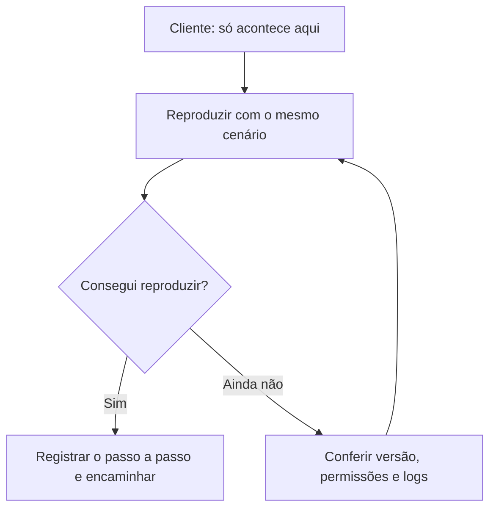

<h1 align="center">👋 Carlos Eduardo Silva Costa</h1>

<strong>Suporte N2 pleno · Implantação de ERP · Desenvolvimento Full Stack em formação</strong>

  
  

> “Só acontece na máquina do cliente” é onde a investigação começa. 🔍

Sou estudante de **Análise e Desenvolvimento de Sistemas** e trabalho há **5 anos com suporte técnico N2 pleno para sistemas ERP**. Na **BENU ERP**, também atuo com implantação de software ERP. Nos meus projetos, pratico como ligar interfaces, APIs e bancos de dados.

## 🧰 O que estou praticando

## 🚀 Projetos

| Projeto | O que você encontra |
| --- | --- |
| 📸 [LM SportsFoto](https://github.com/EduSilva0201/lm-sportsfoto) | Portfólio de fotografia esportiva com catálogo de eventos, filtros e painel administrativo. Backend local em Node.js e SQLite, com uma versão separada para Cloudflare Workers, D1 e R2. |
| 🛍️ [Mascavo Fitwear](https://github.com/EduSilva0201/mascavo-fitwear) | Vitrine de moda fitness com variações, sacola e autenticação. Backend local em Cloudflare Workers e D1. O checkout está em desenvolvimento. |
| 📚 [Estudaí](https://github.com/EduSilva0201/controle-tarefas-estudo) | Organizador de tarefas de estudo com filtros por disciplina, acompanhamento de progresso e salvamento no navegador. |
| 🧳 [Viajô](https://github.com/EduSilva0201/viajo-2) | Página acadêmica de turismo com galeria de destinos, mapa e formulário demonstrativo em HTML e CSS. |
| 🎃 [WICKED](https://github.com/EduSilva0201/wicked-halloween-bootstrap) | Site acadêmico de Halloween com carrossel, acordeão, menu lateral e modal feitos com Bootstrap. |

## 🐛 Como um bug vira chamado de N2

🎲 Abra para ver a pergunta bônus do suporte

**Você lembra o que clicou antes de aparecer a mensagem?**  
O print mostra onde o problema apareceu. O passo a passo ajuda a descobrir como ele começou.

[Pesquisa de perfis e reflexão sobre meu portfólio](BENCHMARKING.md)
